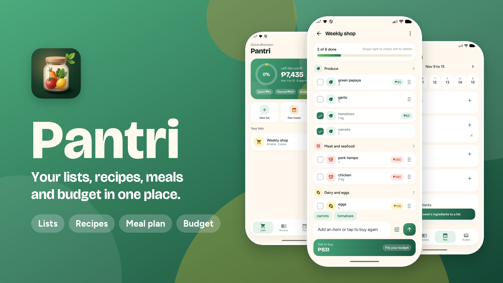

<h1>Pantri</h1>

<b>A lively grocery app that keeps your lists, recipes, meal plan and budget in one place.</b>

<h2>About</h2>

Pantri is a private grocery app for one person. You write your shopping lists, type in the recipes you love, plan your meals for the week, and watch how much of your budget is left. Your budget follows your pay days: one budget for the 1st to the 15th, and one for the 16th to the end of the month.

Everything stays on your phone. There is no account, no ads and no tracking.

## Features

- **Shopping lists.** Make as many lists as you like. Add items fast, with the quantity, unit, price and a note.
- **Smart adding.** Pantri remembers what you buy. It suggests items as you type, guesses the aisle, and brings back your usual price.
- **Aisles.** Items are grouped by aisle (produce, meat, dairy and so on), so the list follows your walk through the store.
- **Easy to use in the store.** Swipe right to check an item off, swipe left to delete it, and tap Undo if you slipped. Hold the handle to drag items into your own order.
- **Buy again and favourites.** Your most-bought items are one tap away.
- **Templates.** Save a list as a template, such as "Weekly shop", and start a fresh copy any time.
- **Prices and totals.** See what is still to buy, and whether it fits what you have left.
- **Price history.** See what an item cost the last few times you bought it.
- **Cutoff budget.** Set your budget in pesos for each pay period. Checking an item off counts it as spent. See what is left, where the money went, and how you did in past cutoffs.
- **Recipe book.** Type in a recipe from anywhere, with its ingredients and steps. One tap sends the ingredients to a list, and you can untick the ones you already have.
- **Meal plan.** Plan breakfast, lunch, dinner and snacks for each day. One tap adds the whole week's ingredients to a list, and matching items add up.
- **Light and dark.** Pantri starts in light mode. Turn on dark mode in Settings.
- **Safe with your typing.** Turning your phone or switching apps never loses what you were typing.

## Getting started

1. Install Android Studio and JDK 21, then open this folder.
2. Connect your phone with USB debugging on, or start an Android emulator.
3. Run `gradlew.bat installRelease` in this folder, or press Run in Android Studio.
4. Open Pantri. Tap **New list** to start.

To change your budget, tap the green card on the home screen (this cutoff only) or open Settings (every cutoff from now on).

## Requirements

- An Android phone with Android 8.0 or newer.

## Built with

Kotlin, Jetpack Compose with Material 3, Room, DataStore, Navigation Compose, Gradle (Kotlin DSL) with a version catalog. Fonts: Bricolage Grotesque and Figtree (bundled).

## Status

Ready to use.

## License

All Rights Reserved. See [LICENSE](LICENSE).
